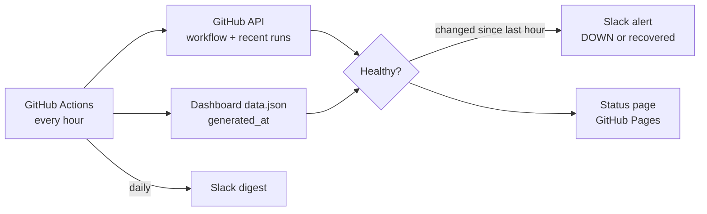

# Automation Health Monitor

Watches a store's automations and tells Slack when one breaks, or quietly stops. Every hour it checks each automation on GitHub, posts to Slack only when something changes, sends a short daily digest, and publishes a live status page.


**Live status page:** [riadmrad1992-blip.github.io/shopify-automation-monitor](https://riadmrad1992-blip.github.io/shopify-automation-monitor/)

Project 4 of an e-commerce automation portfolio by **Riad Mrad**:
[1. Sales Alerts](https://github.com/riadmrad1992-blip/shopify-sales-alerts) ·
[2. Profit Dashboard](https://github.com/riadmrad1992-blip/shopify-profit-dashboard) ·
[3. Support Triage](https://github.com/riadmrad1992-blip/shopify-support-triage) ·
4. Health Monitor

---

## Why it exists

Each automation already alerts Slack when a run fails. That misses the more dangerous case: **when nothing runs at all.** No failure, no alert, just silence. On GitHub this happens for a documented reason: [scheduled workflows are switched off automatically after 60 days without repository activity](https://docs.github.com/en/actions/how-tos/manage-workflow-runs/disable-and-enable-workflows). An automation that works perfectly will stop on its own once nobody edits the repo.

## What it checks, every hour

| Check | Catches |
|---|---|
| Workflow still enabled | GitHub's 60-day auto-disable, or a manual disable |
| Last run passed | A failed run, even if its own alert didn't get through |
| Recent successful run | A schedule that silently stopped (each automation has its own window: 26h for daily jobs, 2h for the 15-minute inbox triage) |
| Published data is fresh | The profit dashboard's `data.json` timestamp, so a green run that published stale numbers is still caught |



## Alerts that people keep reading

- **Only on change:** one message when an automation goes down, one when it recovers, with how long it was down.
- **One reminder a day** while something stays broken, never a message every hour.
- **A daily digest** (default 07:00 UTC): "All 3 automations healthy", plus each one's last success and success rate. If the digest stops arriving, the monitor itself has stopped, which makes the digest a dead man's switch for the watcher.
- **Optional self-repair:** add a `MONITOR_TOKEN` secret (a fine-grained token with Actions read and write on the watched repos) and a disabled schedule is switched back on automatically, then reported.

## Setup

1. List the automations in `monitors.json` (repo, workflow file, allowed hours since the last success, and an optional `data_url`).
2. Add the `SLACK_WEBHOOK_URL` secret. The watched repos are public, so GitHub's built-in token reads them; no other secret is needed.
3. Settings → Pages → Source: **GitHub Actions**.
4. Actions → Automation monitor → **Run workflow** (tick "Send the daily Slack digest now" for a first test).

State between runs (last status, alert times, 48 hours of history) is kept in the Actions cache, so the monitor doesn't commit to the repo every hour.

```bash
python monitor.py --dry-run --digest      # print alerts and digest, post nothing
python -m unittest discover -s tests -v   # 16 tests, no network needed
```

## Project structure

```
monitor.py          # fetch from GitHub, alert Slack, write the status page
monitor_core.py     # pure logic: health rules, change detection, digest, history (unit-tested)
monitors.json       # what to watch
tests/              # unit tests
.github/workflows/  # hourly monitor + Pages deploy, tests on push
```
